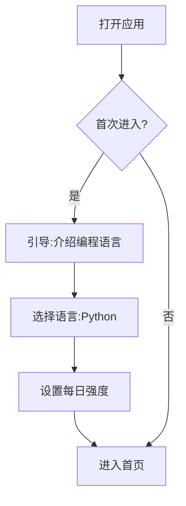
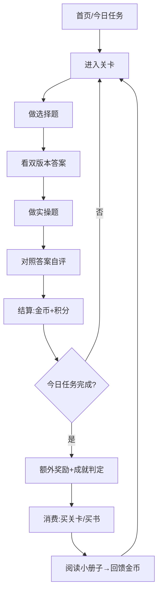

# 趣编（QuBian）· 产品需求文档（PRD）

> Product Requirements Document
> 版本：v1.0 ｜ 状态：待评审 ｜ 更新日期：2026-11-24
> 项目定位：面向零基础与进阶学习者的游戏化编程学习 Web 应用（PWA）

---

## 0. 文档信息

| 项目 | 内容 |
|---|---|
| 产品名称 | 趣编（中文显示名） |
| 仓库名称 | `qubian`（拼音，待 GitHub 占用核实） |
| Slogan | 趣编 · 让编程有趣又易懂 |
| 文档版本 | v1.0 |
| 文档状态 | 待评审 |
| 目标读者 | 项目维护者与贡献者 |
| 相关文档 | 02-架构设计.md、03-技术决策记录ADR.md、04-UIUX设计规范.md、05-题库数据规范.md |

---

## 1. 项目概述

### 1.1 背景与问题陈述

本项目的立项源于一个真实而普遍的痛点：编程初学者普遍觉得传统学习材料枯燥难懂，容易半途而废，且缺少亲手实践的机会。

由此暴露出三个层层递进的问题：

1. **动机问题**：传统编程学习材料枯燥，零基础者难以坚持，中途放弃率高。
2. **理解问题**：现有教程与题库要么过于术语化（看不懂），要么过于浅薄（学不会），缺少"同一知识点、两种深度"的表达。
3. **动手问题**：只看懂讲解不等于会写代码，缺少低门槛、可即时反馈的动手练习环节。

### 1.2 产品愿景

**一句话愿景**：把"学编程"变成一场有目标、有反馈、有奖励的闯关游戏，让零基础者在不知不觉中学会编程，同时让有基础者能快速查漏补缺。

**产品隐喻**：像玩游戏一样学编程——做题得金币，金币买关卡和书，看书再得金币，形成自我驱动的循环。

### 1.3 产品目标

| 层级 | 目标 | 衡量方向（后续量化） |
|---|---|---|
| 用户目标 | 让零基础用户"看得懂、愿意学、学得会" | 完课率、连续学习天数、实操题完成率 |
| 产品目标 | 做出一个可持续维护、面向大众的开源学习产品 | 开源 Star、贡献者数、题库规模 |
| 建设目标 | 在造产品的过程中真正学会编程与产品构建 | 能独立读懂/改造代码，交付可运行版本 |

### 1.4 非目标（明确不做，避免过度设计）

> 这一节极其重要——它划定了本项目的边界，是"避免过度设计"的护栏。

| 不做的事 | 原因 | 何时可能 reconsider |
|---|---|---|
| **不做后端 / 服务器 / 账号系统** | 起步阶段纯前端即可验证玩法；零运维成本 | 用户强烈要求云同步、排行榜时 |
| **不做云同步 / 多人排行榜** | 依赖后端，与"暂不做后端"冲突 | 引入后端之后 |
| **不做付费 / 内购 / 商业化** | 定位为不商用、开源产品 | 产品定位调整时 |
| **不做原生 App / 桌面 App** | Web + PWA 已覆盖主要场景，零上架成本 | 出现明确性能或分发需求时 |
| **不教 Rust 等系统级语言（起步）** | 概念过难，会劝退零基础用户 | 产品跑通后作为第二语言评估 |
| **不做自动判题沙箱（起步）** | judge0 等需 Docker 部署，部署门槛高 | 中期上 Pyodide，后期评估 judge0 |
| **不复制外部书籍正文** | 版权风险，SA 条款会绑定产品许可 | 永远不做（只做导航卡片） |
| **不做花哨的 AI 特效堆砌** | 与"去 AI 味、克制高级"的审美目标冲突 | 最多保留 1 处点睛效果 |

### 1.5 成功标准（MVP 验收）

一个最小可用版本（MVP）成功的标准是：

1. 用户能打开网页 → 走完"选语言 → 设强度 → 做题 → 看双版本答案 → 得金币"的完整闭环；
2. 至少有一套可运行的 Python 入门题库（选择题为主，含双版本答案）；
3. 金币经济循环能跑通（做题得币 → 买下一关/小册子）；
4. 进度可靠地保存在浏览器本地，刷新不丢；
5. 深浅色跟随系统且可手动切换；
6. 界面呈现克制的液态玻璃质感，无明显"AI 味"。

---

## 2. 用户分析

### 2.1 目标用户画像

本项目服务两类用户，这正好让"双版本答案"设计产生最大价值。

| 维度 | 画像 A：零基础同路人（核心） | 画像 B：有基础进阶者 |
|---|---|---|
| 典型代表 | 入门级学习者 | 学过一门语言、想转 Python 或补基础的人 |
| 基础 | 英语/数学底子差，看不懂术语 | 懂基本编程概念 |
| 核心诉求 | "用大白话给我讲明白，别劝退我" | "给我规范的原理和完整代码，别太啰嗦" |
| 阅读偏好 | 大白话版答案、生活比喻、逐行解释 | 专业版答案、术语准确、可直接运行代码 |
| 最大恐惧 | 枯燥、看不懂、坚持不下去 | 内容太浅、浪费时间 |
| 产品要给的 | 鼓励、即时反馈、低门槛动手 | 深度、效率、可跳读 |

> **设计洞察**：同一道题配"专业版 + 大白话版"两份答案，让两类用户各取所需，这是本项目相对于 GitHub 上现成题库（均只有单一讲解）的核心差异化。

### 2.2 用户旅程（ happiness path ）

```
首次进入 → 引导介绍（认识编程/选语言）→ 设置学习强度（每天几题）
   → 每日进入 → 做选择题（概念）→ 做实操题（写代码）
   → 看双版本答案（不懂看大白话 / 想深入看专业版）
   → 结算（得金币 + 积分）→ 达成任务/成就/升级
   → 消费（金币买下一关 / 买小册子）
   → 阅读小册子（看完返金币）→ 回到做题，循环
```

### 2.3 核心痛点与产品对策映射

| 核心痛点 | 产品对策 | 对应功能 |
|---|---|---|
| "编程语言我本身看不懂" | 大白话版答案 + 生活比喻 | 双版本答案系统 |
| "学不进枯燥内容" | 金币、关卡、成就、等级的游戏化外壳 | 游戏化系统 + 经济循环 |
| "看懂了但写不出来" | 实操题 + 浏览器内代码编辑与判题 | 实操题 + Pyodide 判题 |
| "怎么能坚持玩下去" | 每日任务、连续打卡、经济闭环 | 每日任务 + 经济循环 |
| "题库/书籍从哪来" | AI 原创生成 + Python 自动验证 + 小册子 | 题库工具链 + 书城 |

---

## 3. 产品范围与版本规划

采用 MoSCoW 优先级法（Must / Should / Could / Won't），分三期交付，避免一次性全做导致崩溃。

### 3.1 MVP（第一期，Must）—— 最小可用闭环

| 模块 | MVP 范围 |
|---|---|
| 入门引导 | 介绍编程语言、选择语言、设置每日题量 |
| 题库 | Python 入门选择题一套（约 20–30 题），每题双版本答案 |
| 答题 | 选择题前端即时判分 + 答完显示双版本解析 |
| 判题 | 实操题"对照参考答案自评"（不自动判分） |
| 经济 | 金币产出 + 金币解锁下一关 +购买小册子 |
| 书城 | 小册子（双版本答案汇编，网页内嵌阅读）+ 外部书籍导航卡片 |
| 游戏化 | 每日任务、积分、等级（成就可先留接口） |
| 设置 | 深浅色跟随系统 + 手动切换 |
| 平台 | Web + PWA（可添加到主屏幕）、响应式 |
| 存储 | 浏览器 localStorage 本地持久化 |

### 3.2 第二期（Should）—— 增强能力

- 实操题接入 Pyodide，浏览器内运行 Python 自动判分（无需服务器）；
- AI 生成 + Python 脚本自动验证的题库工具链成型，题库扩容；
- 成就系统完整落地；
- 连续打卡（streak）机制、错题复习队列；
- 题库按入门/进阶分层，覆盖 Python 更多章节。

### 3.3 第三期（Could / 远期）—— 规模化

- 引入第二教学语言（候选：JavaScript）；
- 评估 judge0 判题沙箱以支持多语言；
- 视需求评估后端（云同步、排行榜）——需重新评审"暂不做后端"决策。

---

## 4. 核心概念与术语表

> 便于零基础学习者与贡献者对齐术语。

| 术语 | 大白话解释 |
|---|---|
| 前端 / 界面层 | 用户看得见、点得着的部分（网页本身） |
| 后端 / 服务器 | 运行在远端、处理数据和逻辑的程序（本项目暂不使用） |
| API 请求 | 前端向后端"传话要数据"的机制（本项目纯前端，暂不涉及） |
| 数据库 | 结构化存放数据的仓库（本项目用浏览器本地存储替代） |
| localStorage | 浏览器提供的本地存储，数据存在用户自己电脑上 |
| PWA | 渐进式网页应用，可"添加到主屏幕"，用起来像 App，但无需上架 |
| Pyodide | 一个能把 Python 编译到浏览器运行的开源技术，实现"浏览器内判题" |
| CodeMirror | 网页上的代码编辑器组件（实操题写代码用） |
| 判题 / 沙箱 | 自动运行用户代码并对照测试判断对错的机制（隔离运行环境 = 沙箱） |
| 双版本答案 | 每道题配"专业版"（术语准确）+ "大白话版"（生活比喻）两份解析 |
| 经济循环 | 做题得金币 → 花金币买内容 → 消费又得金币的自驱动闭环 |
| 本地优先（Local-first） | 数据默认存在用户本地、不依赖服务器的设计取向 |
| 组件源码可控 | 把组件源码放进自己仓库（而非当黑盒依赖），随时可改 |

---

## 5. 功能需求总览

### 5.1 功能清单与优先级

| 编号 | 功能模块 | 优先级 | 期次 |
|---|---|---|---|
| F01 | 入门引导（介绍/选语言/设强度） | Must | MVP |
| F02 | 题库系统（选择题/实操题、分层） | Must | MVP |
| F03 | 双版本答案系统 | Must | MVP |
| F04 | 答题与判题（选择题判分/实操题自评/中期 Pyodide） | Must | MVP（判题升级二期） |
| F05 | 金币经济循环 | Must | MVP |
| F06 | 每日任务系统 | Must | MVP |
| F07 | 积分系统 | Must | MVP |
| F08 | 等级与成就系统 | Should | MVP 留接口，二期完整 |
| F09 | 书城（小册子内嵌 + 外部导航） | Must | MVP |
| F10 | 个性化设置（深浅色跟随系统+手动） | Must | MVP |
| F11 | 进度本地持久化 | Must | MVP |
| F12 | PWA 支持 | Should | MVP |
| F13 | 连续打卡 / 错题复习 | Could | 二期 |
| F14 | 题库自动生成与验证工具链 | Should | 二期 |

### 5.2 功能架构图

```
趣编 QuBian
├── 引导与设置
│   ├── F01 入门引导（语言介绍 / 选语言 / 设每日强度）
│   └── F10 个性化设置（主题 / 学习偏好）
├── 学习核心
│   ├── F02 题库系统（选择题 / 实操题 / 难度分层）
│   ├── F03 双版本答案（专业版 / 大白话版）
│   └── F04 答题判题（即时判分 / 代码编辑 / Pyodide 判题）
├── 激励系统
│   ├── F05 金币经济循环（产出 / 消费 / 回馈）
│   ├── F06 每日任务
│   ├── F07 积分
│   └── F08 等级 / 成就
├── 内容消费
│   └── F09 书城（我的小册子 / 外部书籍导航）
└── 基础设施
    ├── F11 本地持久化（localStorage）
    └── F12 PWA / 响应式 / 深浅色
```

---

## 6. 详细功能需求

> 每个功能按"功能描述 → 用户故事 → 业务规则 → 验收标准"描述。验收标准用 Given/When/Then 风格，便于开发自测。

### F01 入门引导

**功能描述**：新用户首次进入时，用轻量的引导流程完成三件事——认识编程语言、选择要学的语言、设定每日学习强度。

**用户故事**：
- 作为零基础用户，我希望首次进入时有清晰引导，而不是一脸茫然地看到一堆题目。
- 作为用户，我希望能自己设定"每天做几题"，让学习节奏可控。

**业务规则**：
1. 引导只在首次进入（本地无引导完成标记）时出现，之后可跳过；
2. 第一批可选语言：Python（唯一完整可用）；其他语言可显示"即将上线"占位；
3. 每日强度提供档位选择（如 3 / 5 / 10 题），默认值建议 5；
4. 引导完成状态写入本地存储。

**验收标准**：
- Given 新用户首次打开，When 进入应用，Then 显示引导流程而非直接跳到题目；
- Given 用户选择 Python 并设强度 5，When 完成引导，Then 首页显示"每日目标 5 题"且引导不再出现；
- Given 用户中途关闭引导，When 下次进入，Then 引导从中断处继续或可重新进入。

### F02 题库系统

**功能描述**：按语言、章节、题型、难度组织题目；MVP 以 Python 入门选择题为主，实操题为辅。

**用户故事**：
- 作为用户，我希望题目按章节和难度排列，能循序渐进，也能回头复习。
- 作为有基础用户，我希望能按难度筛选，快速定位适合我的题。

**业务规则**：
1. 题型两类：选择题（测概念）、实操题（练写代码）；
2. 难度两级起步：入门 / 进阶；
3. 每题归属一个章节；关卡（level）由若干题目组成，下一关默认锁定；
4. 题目数据来自 JSON 结构化文件（详见 05-题库数据规范.md），格式统一，便于 AI 批量生成；
5. 题目内容版权干净：以 AI 原创为主，MIT 许可题库仅作结构参考；不混入力扣快照、CC BY-NC-ND 内容。

**验收标准**：
- Given 题库 JSON，When 应用加载，Then 按章节/难度正确分组展示；
- Given 某关未解锁，When 用户点击，Then 提示"需要 X 金币解锁"而非直接进入；
- Given 一道实操题，When 展示，Then 显示代码编辑器与参考代码入口。

### F03 双版本答案系统（核心差异化）

**功能描述**：每道题提供两份答案——专业版（术语准确、适合有基础）与大白话版（生活比喻、适合零基础）。

**用户故事**：
- 作为零基础用户，我希望在答完后看到"说人话"的解析，让我真正理解。
- 作为有基础用户，我希望看到规范的原理讲解和完整代码，不希望被过度简化。

**业务规则**：
1. 两份答案默认折叠，用户主动切换/展开；默认展示大白话版（照顾核心用户）；
2. 选择题：专业版用规范术语讲原理，大白话版用生活比喻讲"为什么选这个"；
3. 实操题：专业版给标准代码 + 注释，大白话版逐行解释"这行在干嘛、为什么要写"；
4. 答案文案规范详见 05-题库数据规范.md。

**验收标准**：
- Given 用户答完任意题，When 展开答案，Then 可在"专业版 / 大白话版"间切换；
- Given 一道题，When 查看数据，Then 两个答案字段均非空且风格符合规范；
- Given 默认设置，When 首次展开答案，Then 默认显示大白话版。

### F04 答题与判题

**功能描述**：选择题前端即时判分；实操题起步用"对照参考答案自评"，二期接入 Pyodide 自动判分。

**用户故事**：
- 作为用户，我希望答完立刻知道对错，并看到解析，形成即时反馈。
- 作为用户，我希望实操题能写代码、跑起来、看到结果（二期）。

**业务规则**：
1. 选择题：提交后前端比对正确答案，立即显示对错 + 双版本解析；
2. 实操题（MVP）：用户写代码后，展示参考答案供对照，用户自评"我懂了 / 还需练习"；
3. 实操题（二期）：Pyodide 在浏览器内运行用户代码，对照测试用例自动判分；代码不上传、不离开用户电脑；
4. 答对触发金币 + 积分奖励；答错不扣分，鼓励重试。

**验收标准**：
- Given 用户答对选择题，When 提交，Then 显示"正确"、发放金币和积分、展示双版本解析；
- Given 用户答错，When 提交，Then 显示"再想想"、展示解析、不扣金币、可重试；
- Given（二期）实操题，When 提交代码，Then 浏览器内运行测试并显示通过/失败，无需服务器。

### F05 金币经济循环（灵魂机制）

**功能描述**：金币是贯穿产品的核心激励货币，形成"产出 → 消费 → 回馈"闭环。

**业务规则**：

| 环节 | 规则 | 数值（示例，可配置） |
|---|---|---|
| 产出 | 答对选择题得金币 | +5 / 题 |
| 产出 | 完成每日任务得金币 | +20 |
| 产出 | 读完一本小册子得金币 | +30 |
| 消费 | 解锁下一关 | 50 金币 |
| 消费 | 购买小册子 | 40 金币 |
| 回馈 | 买书/通关后通过阅读/复习再得金币 | 见上 |

> 所有数值集中为配置项，便于后期调优经济平衡。

**设计风险（需在二期补强）**：目前金币只有"产出 + 一次性消费"，长期消耗场景不足。二期需补充如"装饰性道具""成就专属内容"等持续消耗点，否则老用户玩腻后激励失效。

**验收标准**：
- Given 用户有足够金币，When 购买关卡/小册子，Then 金币扣减、内容解锁、状态持久化；
- Given 金币不足，When 尝试购买，Then 提示差额且不允许购买；
- Given 用户读完小册子，When 标记完成，Then 发放回馈金币。

### F06 每日任务系统

**功能描述**：根据用户设定的强度生成每日任务，完成后给予金币/积分奖励，培养习惯。

**业务规则**：
1. 每日任务由"今日做题数 = 设定强度"生成；
2. 任务状态每日重置（按本地日期判断）；
3. 完成今日任务发放额外金币 + 积分；
4. 任务完成度在首页可视化（进度条/环形）。

**验收标准**：
- Given 设定强度 5，When 当天完成 5 题，Then 今日任务标记完成并发奖励；
- Given 跨天，When 用户进入，Then 任务重置为新的一天。

### F07 积分系统

**功能描述**：积分是仅次于金币的成就型数值，累计不消耗，用于等级计算与成就感。

**业务规则**：
1. 答对题、完成任务、解锁成就均得积分；
2. 积分只增不减；
3. 积分累计驱动等级提升。

**验收标准**：
- Given 用户获得积分，When 查看个人页，Then 积分总数与明细（可选）正确显示。

### F08 等级与成就系统

**功能描述**：等级由积分累计解锁；成就由特定行为触发（首次答对、连续打卡、通关章节等）。

**业务规则**：
1. 等级阈值按积分配置（如每 100 分升 1 级）；
2. 成就在 MVP 阶段先定义数据结构与接口，二期完整实现触发逻辑与展示；
3. 成就/升级时给予金币奖励。

**验收标准**：
- Given 积分达到阈值，When 系统结算，Then 等级提升并提示；
- Given（二期）用户满足成就条件，When 触发，Then 成就点亮并发奖励。

### F09 书城

**功能描述**：两个板块——"我的小册子"（自产内容，金币购买，内嵌网页阅读）与"外部书籍导航"（他人内容，链接卡片，免费开放）。

**业务规则**：

| 板块 | 内容来源 | 版权处理 | 是否消耗金币 | 阅读方式 |
|---|---|---|---|---|
| 我的小册子 | 双版本答案按章节汇编 | 原创，版权干净 | 是（购买后永久可读） | 网页内嵌阅读器 |
| 外部书籍导航 | GitHub 上明确许可的书籍/项目 | 只放链接卡片（书名/作者/简介/许可徽章），不复制正文 | 否（免费开放） | 跳转原站 |

版权分级（详见 03-技术决策记录）：
- 🟢 可内嵌正文：MIT / CC0 / CC BY（署名即可）；
- 🟡 只做导航：CC BY-SA / CC BY-NC-SA（避免 SA 条款绑定产品许可）；
- 🔴 只放链接或干脆不收：CC BY-NC-ND / 未标明许可 / 力扣题库快照。

**验收标准**：
- Given 用户金币充足，When 购买小册子，Then 可在内嵌阅读器中阅读；
- Given 用户点击外部书籍卡片，When 跳转，Then 打开原站链接，且卡片标注许可与来源；
- Given 外部书籍，When 浏览，Then 免费无需金币。

### F10 个性化设置

**功能描述**：深浅色主题跟随系统（prefers-color-scheme）并可手动切换；学习偏好可调整。

**业务规则**：
1. 默认主题 = 跟随系统；
2. 用户可手动覆盖为浅色 / 深色，覆盖后记住选择；
3. 主题状态持久化到本地；
4. 液态玻璃在深浅两套主题下均保持文字清晰、对比度达标。

**验收标准**：
- Given 系统为深色且用户未手动设置，When 打开应用，Then 显示深色主题；
- Given 用户手动切换为浅色，When 刷新，Then 保持浅色；
- Given 任意主题，When 查看玻璃元素，Then 文字对比度满足可访问性要求。

### F11 进度本地持久化

**功能描述**：所有用户数据（金币、积分、等级、答题进度、解锁状态、设置）存于浏览器 localStorage。

**业务规则**：
1. 定义统一的数据模型（用户档案、进度、设置）；
2. 关键操作后即时写入，防止刷新丢失；
3. 提供"清除数据"入口（需二次确认，属不可逆操作）；
4. 明确告知用户：换设备或清缓存会丢进度（无后端）。

**验收标准**：
- Given 用户完成答题，When 刷新页面，Then 金币/进度/设置保持不变；
- Given 用户点击清除数据，When 二次确认，Then 数据被清空并回到初始状态。

### F12 PWA 支持

**功能描述**：让网页可"添加到主屏幕"，具备离线打开能力。

**业务规则**：
1. 提供 Web App Manifest（名称、图标、主题色、启动方式）；
2. 注册 Service Worker 缓存核心资源，支持离线打开已缓存内容；
3. 题库数据随应用打包，离线可做题。

**验收标准**：
- Given 支持的浏览器，When 用户选择"添加到主屏幕"，Then 生成桌面图标；
- Given 断网，When 打开已安装应用，Then 能进入并做已缓存的题目。

---

## 7. 核心玩法与经济循环详解

### 7.1 经济循环（产品灵魂）

```
         ┌──────────────── 回馈 ────────────────┐
         │                                      │
   做题得金币 ──→ 金币 ──→ 买下一关 / 买小册子 ──┘
     ↑                          │
     └──── 看书/复习再得金币 ←────┘
```

- **产出端**：做题、完成任务、读完小册子；
- **消费端**：解锁关卡、购买小册子；
- **回馈端**：消费后的阅读/复习行为再次产币，闭合循环。

**待补漏洞**：长期消耗场景不足（见 F05 风险），二期补强。

### 7.2 双版本答案（差异化）

- 同一题目，两种深度；
- 零基础看大白话、有基础看专业版；
- 把"做产品"和"学会编程"缝在一起：把知识讲清楚 = 真正学会的标志。

### 7.3 游戏化外壳

- 每日任务 + 积分 + 成就 + 等级 = 把"学编程"包装成"玩游戏"；
- 直击"学不进枯燥内容"的痛点。

---

## 8. 关键用户流程

### 8.1 新用户首次流程



### 8.2 每日学习流程



---

## 9. 非功能需求

| 类别 | 需求 |
|---|---|
| 性能 | 首屏加载快；答题交互即时响应；题库数据按需加载，避免单文件过大 |
| 可用性 | 引导清晰；错误操作有提示；不可逆操作（清数据）需二次确认 |
| 可访问性 | 文字对比度达标；支持键盘操作；尊重系统"减少动态效果"偏好 |
| 兼容性 | 主流现代浏览器（Chrome / Safari / Firefox）；移动端与桌面端响应式 |
| 隐私 | 数据默认存本地，不上传；无账号、不收集个人信息 |
| 安全 | 代码仅在本地浏览器运行；不执行不可信远端代码（判题在隔离环境） |
| 可维护性 | 分层、模块化、低耦合；组件源码可控；文档与代码同步 |
| 版权合规 | 只使用 MIT / CC0 / CC BY 内容或 AI 原创；外部书只做导航；保留第三方许可 |

---

## 10. 约束与假设

| 约束 | 说明 |
|---|---|
| 无后端 | 一切功能在本地浏览器完成；无云同步、无排行榜 |
| 单一教学语言起步 | Python 为第一批唯一语言 |
| 开源不商用 | 主代码 Apache-2.0；第三方组件保留原许可 |
| 面向零基础 | 代码需文档化、可验证、易于维护 |
| 平台 | Web + PWA，响应式 |
| 审美 | 去 AI 味的液态玻璃，克制、高级 |

**关键假设**：
- 用户设备浏览器支持 localStorage 与较新的 CSS（backdrop-filter）；
- Pyodide 二期可在目标浏览器运行（一期不依赖它）。

---

## 11. 数据需求概览

> 详细结构见 05-题库数据规范.md；架构数据层见 02-架构设计.md。

| 数据实体 | 主要字段 | 存储位置 |
|---|---|---|
| 题目 | id、题型、章节、难度、题干、选项、双版本答案、参考代码、测试用例 | JSON 文件（随应用打包） |
| 用户档案 | 金币、积分、等级、已解锁关卡、已购小册子 | localStorage |
| 学习进度 | 各题作答状态、今日任务进度、连续天数 | localStorage |
| 设置 | 主题偏好、每日强度 | localStorage |
| 成就定义 | id、名称、条件、奖励 | 配置/代码常量 |

---

## 12. 风险与缓解

| 风险 | 影响 | 缓解措施 |
|---|---|---|
| 范围过大，一次做不完 | 项目烂尾 | 严格按 MVP → 二期 → 三期交付，每期可验证 |
| 题库版权雷区 | 开源后法律纠纷 | 只 AI 原创 + MIT 内容；外部书只导航 |
| "看懂 ≠ 会写" | 学习效果落空 | 实操题 + 二期 Pyodide 自动判题 |
| 金币长期消耗不足 | 老用户流失 | 二期补持续消耗场景 |
| 单文件 God Object | 难以维护 | 架构层强制分层、模块化（见 02） |
| 液态玻璃做成 AI 味 | 审美目标落空 | 遵循 04-UIUX 设计规范，克制用特效 |
| 无后端导致进度易丢 | 用户不满 | 明确告知 + 后续评估云同步 |
| 零基础开发门槛 | 交付困难 | AI 主力编写 + 分阶段最小版本 + 文档化 |

---

## 13. 路线图（Roadmap）

```
第一期 MVP（当前）  可跑通的最小闭环：引导→做题→双答案→金币→书城→本地存储→PWA→深浅色
        ↓
第二期 增强         Pyodide 自动判题 + AI 题库工具链 + 成就完整 + 连续打卡 + 错题复习
        ↓
第三期 规模化       第二语言 + 多语言判题评估 + 后端（云同步/排行榜）重新评审
```

---

## 14. 待定问题

| # | 问题 | 影响 |
|---|---|---|
| 1 | 仓库名 `qubian` 是否已被 GitHub 占用？（待核实） | 命名落地 |
| 2 | 金币各项数值（+5 / 50 / 40 等）是否采用示例值？ | 经济平衡 |
| 3 | 成就的具体清单与触发条件？ | 二期实现范围 |
| 4 | 外部书籍首批收录哪些？（需逐一核实许可） | 书城内容 |
| 5 | 是否要"清除数据"入口？（本 PRD 暂定要，属不可逆操作） | 设置页范围 |

