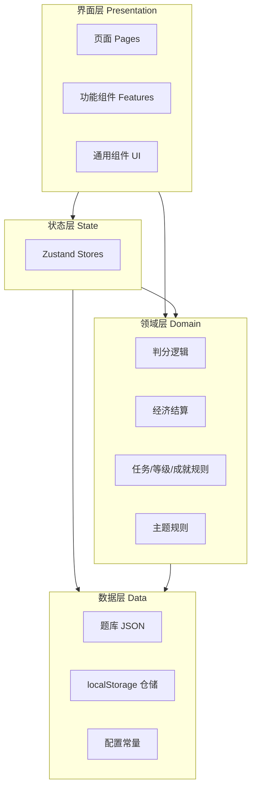
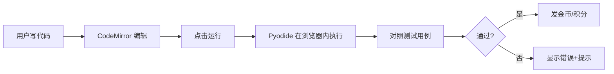
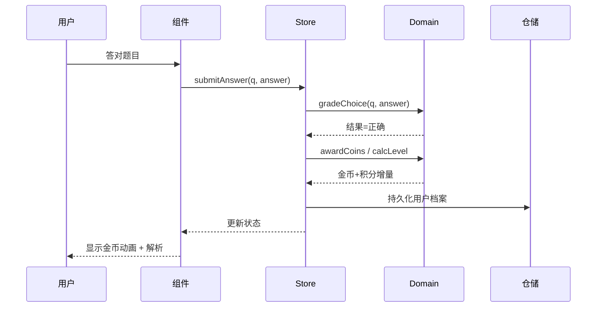

# 趣编（QuBian）· 架构设计文档

> Architecture Design Document
> 版本：v1.0 ｜ 状态：待评审 ｜ 更新日期：2026-11-24
> 设计目标：低耦合 · 分层 · 模块化 · 可收口 · 避免过度设计

---

## 0. 文档信息

| 项目 | 内容 |
|---|---|
| 文档版本 | v1.0 |
| 文档状态 | 待评审 |
| 相关文档 | 01-PRD.md、03-技术决策记录ADR.md、04-UIUX设计规范.md、05-题库数据规范.md |
| 架构风格 | 纯前端本地优先（Local-first）+ 分层模块化单体（Modular Monolith） |

---

## 1. 架构目标与原则

### 1.1 六大目标

| 目标 | 具体含义 |
|---|---|
| **低耦合** | 模块之间通过明确接口通信，改一个模块不牵连其他模块 |
| **分层** | 按职责垂直分层，依赖只能单向（上层依赖下层，下层不 reverse 依赖上层） |
| **模块化** | 每个功能域是独立模块，有自己的数据、逻辑、界面 |
| **可收口** | 有清晰的"总装入口"，零散模块最终汇聚到少数几个装配点，不散落全局 |
| **避免过度设计** | 不引入用不上的库、不搞微服务、不为假想需求提前抽象 |
| **可验证** | 每层、每个模块都能单独运行/测试，便于 AI 分阶段交付最小版本 |

### 1.2 架构原则（决策护栏）

1. **单向依赖**：依赖方向严格自上而下，禁止下层 import 上层。
2. **状态集中**：跨模块共享状态放状态层（Zustand），模块内部状态留在组件内。
3. **纯函数优先**：领域逻辑（判分、金币结算、等级计算）写成纯函数，无副作用，好测试。
4. **数据与界面分离**：题目数据是纯 JSON，界面只负责渲染，不在数据里混入 UI 逻辑。
5. **装配点收口**：全局 Provider、路由、Store 装配集中在少数入口文件。
6. **按需引入依赖**：不预装用不上的库（详见第 3 节依赖策略）。

---

## 2. 技术栈总览

| 层次 | 技术选型 | 职责 | 状态 |
|---|---|---|---|
| 框架 | React + TypeScript + Vite | 界面构建、类型安全、开发/打包 | ✅ 定 |
| 样式 | Tailwind CSS | 原子化样式，快速一致 | ✅ 定 |
| 基础组件 | shadcn/ui（源码进仓库） | 按钮/弹窗/卡片等基础件，源码可控 | ✅ 定 |
| 图标 | Lucide React | 统一图标 | ✅ 定 |
| 动画 | Motion（或纯 CSS） | 有意义的交互反馈；克制使用 | ✅ 定 |
| 状态管理 | Zustand | 金币/积分/进度等全局状态 | ✅ 定 |
| 代码编辑器 | @uiw/react-codemirror | 实操题写代码 | ✅ 定 |
| 判题 | Pyodide | 浏览器内运行 Python 自动判题 | ✅ 定（二期启用） |
| 玻璃视觉 | 手写 CSS 为主 + glasscn 参考 | 液态玻璃质感，去 AI 味 | ✅ 定 |
| 本地存储 | localStorage | 进度/设置/经济数据持久化 | ✅ 定 |
| PWA | Manifest + Service Worker | 添加到主屏幕、离线打开 | ✅ 定 |
| 测试 | Vitest（单测）+ Playwright（E2E，可选） | 验证领域逻辑与关键流程 | ✅ 建议 |
| 部署 | GitHub Pages | 免费静态托管 | ✅ 定 |
| **不引入** | TanStack Query / dnd-kit / Recharts / Magic UI 全套 / Aceternity UI 全套 / 后端 | 当前无对应需求或违背审美 | ⛔ |

> 依赖选择的完整理由见 03-技术决策记录ADR.md。

---

## 3. 依赖控制策略（避免过度设计）

| 原则 | 做法 |
|---|---|
| 严格按需 | 只装 MVP 真正用到的库；二期用到的二期再装 |
| 功能不重复 | 同类库只留一个（如动画只在 Motion / CSS 间二选一） |
| 效果库克制 | Magic UI / Aceternity UI 遵循"品味地图"规则：全站最多 1 个效果件作点睛，其余克制 |
| 源码可控优先 | 优先 shadcn 这类"源码进仓库"的组件，而非黑盒 npm 包 |
| 定期审计 | 每个依赖都要能说清"解决什么问题"，说不清就移除 |

---

## 4. 整体架构视图



**依赖方向铁律**：界面层 → 状态层 → 领域层 → 数据层。上一层可依赖下一层，反之不可。领域层不认识 React，数据层不认识界面。

---

## 5. 分层设计详解

### 5.1 界面层（Presentation）

**职责**：渲染界面、响应用户交互、展示状态。不含业务规则。

| 子层 | 内容 | 规则 |
|---|---|---|
| 页面（Pages） | 首页、闯关页、书城页、个人页、设置页 | 负责布局与组合，不写业务计算 |
| 功能组件（Features） | 题目卡、答案切换器、金币动画、任务进度环 | 按功能域组织，可复用状态层 |
| 通用组件（UI） | shadcn 基础件 + 自定义玻璃组件 | 纯展示，通过 props 接收数据与回调，不含业务 |

**约束**：组件文件超过约 300 行或职责超过 1 个，必须拆分（见 6.3）。

### 5.2 状态层（State）

**职责**：管理跨模块的全局状态，提供统一的读写接口。

| Store | 管理内容 | 说明 |
|---|---|---|
| `useProfileStore` | 金币、积分、等级、已解锁关卡、已购小册子 | 用户核心资产 |
| `useProgressStore` | 各题作答状态、今日任务进度、连续天数 | 学习进度 |
| `useSettingsStore` | 主题偏好、每日强度 | 用户设置 |

**约束**：
- Store 只暴露动作（action），业务逻辑委托给领域层，Store 本身不改写成大杂烩；
- 每个 Store 单文件，职责单一。

### 5.3 领域层（Domain）

**职责**：承载所有业务规则，纯 TypeScript，无 React、无 DOM，可独立单测。这是"低耦合"的核心。

| 模块 | 关键函数（示例） | 说明 |
|---|---|---|
| `grading.ts` | `gradeChoice(q, answer)` / `gradeCode(q, output)` | 选择题判分、实操题判题对接 |
| `economy.ts` | `awardCoins(reason)` / `spendCoins(cost)` / `canAfford(balance, cost)` | 金币产出/消费/校验 |
| `progression.ts` | `calcLevel(points)` / `checkAchievements(events)` | 等级计算、成就触发 |
| `tasks.ts` | `buildDailyTask(intensity)` / `isTaskComplete(progress)` | 每日任务生成与判定 |
| `theme.ts` | `resolveTheme(pref, system)` | 主题解析规则 |

**约束**：全部为纯函数或明确输入输出的函数，禁止直接读写 localStorage（由数据层仓储负责）。

### 5.4 数据层（Data）

**职责**：数据的定义、加载、持久化。对上提供仓储接口，屏蔽存储细节。

| 模块 | 内容 | 说明 |
|---|---|---|
| `questions/` | 题库 JSON + 类型定义 + 加载器 | 按章节分文件，避免单文件过大 |
| `repositories/storage.ts` | localStorage 读写封装 | 统一序列化、版本迁移、容错 |
| `config/economy.ts` | 金币数值配置 | 经济参数集中，便于调优 |
| `config/achievements.ts` | 成就定义 | 配置化 |

**约束**：存储格式统一走仓储封装，组件/Store 不直接操作 localStorage 原生 API。

---

## 6. 模块化与目录结构

### 6.1 推荐目录结构（按功能域 + 分层）

```
src/
├── app/                        # 装配层：全局收口点
│   ├── App.tsx                 # 根组件：Provider + 路由 装配
│   ├── router.tsx              # 路由定义
│   └── providers.tsx           # 全局 Provider 装配（主题/Store）
├── pages/                      # 页面层（每页一个目录）
│   ├── home/
│   ├── learning/               # 闯关/答题
│   ├── bookstore/
│   ├── profile/
│   └── settings/
├── features/                   # 功能组件（跨页面复用的业务组件）
│   ├── question/
│   │   ├── QuestionCard.tsx
│   │   ├── AnswerPanel.tsx     # 双版本答案切换
│   │   └── CodeEditor.tsx
│   ├── economy/
│   │   ├── CoinBadge.tsx
│   │   └── UnlockDialog.tsx
│   ├── task/
│   │   └── DailyTaskRing.tsx
│   └── book/
│       ├── BookletReader.tsx
│       └── ExternalBookCard.tsx
├── components/ui/              # 通用展示组件（shadcn + 自定义玻璃件）
│   ├── button.tsx
│   ├── glass-card.tsx
│   └── dialog.tsx
├── stores/                     # 状态层
│   ├── profileStore.ts
│   ├── progressStore.ts
│   └── settingsStore.ts
├── domain/                     # 领域层（纯逻辑，可单测）
│   ├── grading.ts
│   ├── economy.ts
│   ├── progression.ts
│   ├── tasks.ts
│   └── theme.ts
├── data/                       # 数据层
│   ├── questions/              # 题库（按章节/语言分文件）
│   │   ├── python-basics.json
│   │   └── index.ts            # 加载/聚合入口
│   ├── repositories/
│   │   └── storage.ts
│   ├── config/
│   │   ├── economy.ts
│   │   └── achievements.ts
│   └── types.ts                # 全局数据契约（题目/用户/设置类型）
├── lib/                        # 通用工具
│   ├── pyodide.ts              # Pyodide 加载与判题封装（二期）
│   └── utils.ts
└── styles/
    ├── globals.css             # Tailwind 入口 + 设计变量
    └── glass.css               # 液态玻璃样式（手写）
```

### 6.2 功能域内聚原则

一个功能域（如 `question`）尽量把相关的组件、逻辑、类型放在一起；跨功能域共享才上提到 `components/ui`、`domain`、`stores`。这样"改一道题的展示"只动 question 目录，不牵全局。

### 6.3 防止"超级大文件"的三条硬规则

1. **单文件职责单一**：一个文件只干一件事；组件 > 300 行或逻辑 > 2 个职责即拆。
2. **页面只做装配**：页面文件只组合组件、传 props，不写业务计算（业务下沉到 domain/stores）。
3. **装配点收口**：Provider、路由、Store 的初始化只在 `app/` 下完成，禁止在各组件里散落全局初始化。

> 这三条是"可收口"的具体落地：模块可以很多，但总装口只有 `app/` 一处，不散、不乱。

---

## 7. 关键技术方案

### 7.1 判题方案（Pyodide，二期）



- Pyodide 通过 CDN 或本地包按需加载，避免拖慢首屏；
- 代码不上传服务器，全程在用户浏览器内；
- 超时/异常捕获，防止死循环卡死页面；
- 一期先做"对照参考答案自评"，二期切换为自动判题，接口在 `domain/grading.ts` 保持稳定，切换不影响上层。

### 7.2 题库自动生成与验证工具链（二期，离线工具）

借鉴 Meta `synth_gen` 的"生成 → 验证 → 自愈"思路（MIT，详见 ADR）：

```
AI 生成题目+答案+测试 
   → Python 脚本验证（语法检查 + 运行测试 + 防弱测试）
   → 不通过则让 AI 重写（自愈循环）
   → 通过才写入题库 JSON
```

- 这是离线工具链，在开发者电脑运行，不进入产品前端，不违反"暂不做后端"；
- 防弱测试：注入几段必然错误的烂代码，要求每个都被判失败，防止"随便写都能过"。

### 7.3 主题方案（跟随系统 + 手动覆盖）

```
resolveTheme(userPref, systemPref):
    if userPref == 'system' → 用 systemPref（dark/light）
    else → 用 userPref
```
- 用 CSS 变量定义两套语义色（背景/文字/玻璃/强调色），Tailwind 映射这些变量；
- 监听 `prefers-color-scheme` 变化，用户未手动覆盖时实时跟随；
- 手动选择持久化到 settingsStore；
- 玻璃样式在两套主题下分别调参，保证文字对比度（见 04-UIUX 规范）。

### 7.4 本地持久化方案

- 统一仓储 `storage.ts` 封装 localStorage；
- 写入带命名空间前缀（如 `qubian:`）和版本号，便于迁移；
- 读取时做容错（JSON 解析失败回退默认值）；
- 关键操作即时写入；数据变更集中经 Store action，避免散落写入。

### 7.5 状态与经济的数据流



---

## 8. 依赖方向与耦合控制

| 规则 | 落地方式 |
|---|---|
| 单向依赖 | ESLint 配置层间 import 限制（如 domain 禁止 import react/components） |
| 接口通信 | 模块间只通过 props / Store action / 类型契约通信 |
| 类型契约集中 | 全局数据类型放 `data/types.ts`，避免各自定义不一致 |
| 逻辑下沉 | 组件不写业务计算，全部委托 domain 纯函数 |
| 配置化 | 金币数值、成就条件、主题色都用配置，不硬编码在逻辑里 |

**"可收口"检查清单**：
- [ ] 所有全局 Provider 只在 `app/providers.tsx` 装配；
- [ ] 所有路由只在 `app/router.tsx` 定义；
- [ ] 所有 Store 只在 `app` 初始化一次；
- [ ] 没有组件直接 import 其他页面的内部文件。

---

## 9. 错误处理与边界情况

| 场景 | 处理策略 |
|---|---|
| 题库 JSON 加载失败 | 显示错误状态 + 重试入口，不白屏 |
| localStorage 不可用/写满 | 降级为内存状态并提示用户 |
| 旧版本数据格式 | 仓储版本号检测 + 迁移/回退默认 |
| Pyodide 加载失败（二期） | 提示网络问题，允许切回"对照自评"模式 |
| 用户代码死循环（二期） | Pyodide 执行超时中断 + 提示 |
| 金币不足 | 购买按钮禁用 + 显示差额 |
| 首次加载慢 | 骨架屏/加载态，减少等待感知 |

所有列表/页面需覆盖 **加载态、错误态、空态** 三态（对齐 UI 规范）。

---

## 10. 性能考量

| 关注点 | 措施 |
|---|---|
| 首屏体积 | 题库按章节分包，按需加载；Pyodide 二期懒加载 |
| 重渲染 | Zustand 选择器细粒度订阅，避免全树重渲染 |
| 大列表 | 题目/书籍列表量大时再考虑虚拟滚动（当前规模不需要，避免过度设计） |
| 玻璃性能 | `backdrop-filter` 只用于浮层，不在大量元素上滥用（见 04 规范） |
| 图片资源 | 图标用 Lucide（矢量），书籍封面用占位直到有真实资源 |

---

## 11. 安全与隐私

- 所有用户数据本地存储，不上传、不联网（除 Pyodide 首次加载可能需 CDN）；
- 用户代码仅在本地浏览器执行，判题在 Pyodide 隔离环境；
- 不收集任何个人信息，无账号系统；
- 不可逆操作（清除数据）需二次确认。

---

## 12. 测试策略

| 层级 | 工具 | 测什么 |
|---|---|---|
| 领域层单测 | Vitest | 判分、金币结算、等级计算、任务判定等纯函数 |
| 组件测试 | Vitest + Testing Library（可选） | 关键交互组件 |
| E2E | Playwright（可选，二期） | 新用户引导→做题→得币的完整流程 |
| 题库校验 | Python 脚本（二期） | 题目格式、答案正确性、防弱测试 |

> 领域层纯函数是测试性价比最高的地方——业务逻辑正确性能被可靠验证。

---

## 13. 部署方案

| 项 | 方案 |
|---|---|
| 托管 | GitHub Pages（免费静态站点） |
| 构建 | `npm run build` 产出静态文件 |
| 自动化 | GitHub Actions：推送到 main 自动构建并部署（配置详见后续部署文档） |
| PWA | 构建产物含 Manifest 与 Service Worker |
| 域名 | 默认 `用户名.github.io/qubian/`；自定义域名可选 |

---

## 14. 扩展点（为未来留门，但不提前实现）

| 扩展方向 | 当前如何"留门" | 未来怎么接 |
|---|---|---|
| 自动判题（二期） | `domain/grading.ts` 接口稳定 | 自评实现替换为 Pyodide 实现 |
| 第二语言 | 题库目录按语言分（`data/questions/<lang>/`） | 新增语言题库 + 选择器 |
| 后端/云同步 | 仓储接口 `repositories/` 抽象 | 替换为调用 API 的仓储实现，上层不变 |
| 排行榜 | 数据层预留用户标识 | 引入后端后新增 |
| 持续消耗（金币） | 经济配置化 | 新增道具/内容消耗点，不改核心逻辑 |

> 这些只是"接口上留门"，不写任何多余实现——这正是"可收口、不过度设计"的体现。

---

## 15. 与通用全栈架构的对应关系

本项目采用业界常见的"前端交互 → API 请求 → 后端服务 → 数据库"全栈架构的**本地化简化版**：

| 通用架构概念 | 本项目落地 |
|---|---|
| 前端交互 | 界面层（React 组件 + 液态玻璃） |
| API 请求 / 后端服务 | 一期无（本地领域层函数替代）；二期判题用 Pyodide 本地执行 |
| 数据库 | localStorage 本地仓储 + JSON 题库文件 |
| UI/UX | 04-UIUX 设计规范 |

> 也就是说：本项目把"后端/数据库"折叠进浏览器本地，以便零运维地先跑通玩法。将来要接入真后端，本架构的仓储层可以随时替换。
