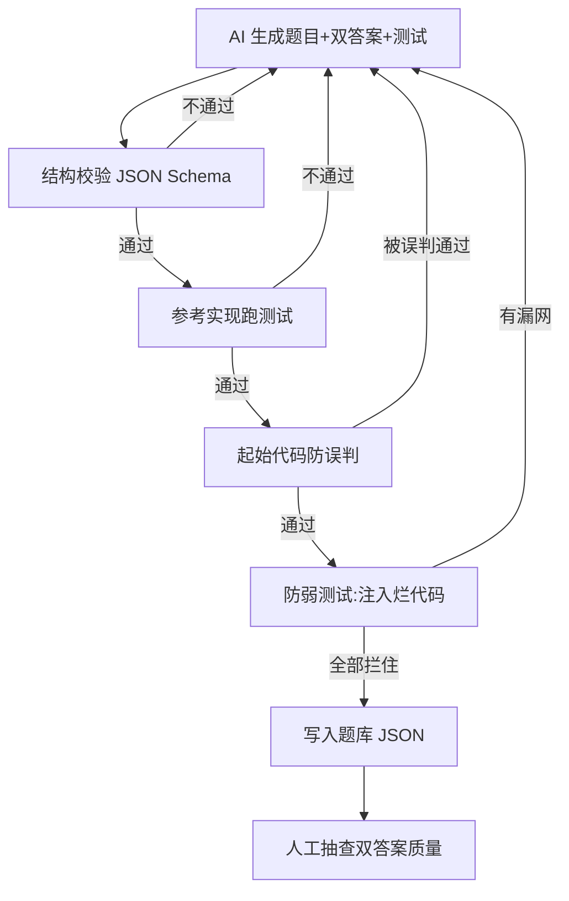

# 趣编（QuBian）· 题库数据规范（Schema）

> Question Bank Data Specification
> 版本：v1.0 ｜ 状态：待评审 ｜ 更新日期：2026-11-24
> 核心地位：题库是本项目最核心的资产，格式必须先定死，AI 批量生成才不会乱

---

## 0. 文档信息

| 项目 | 内容 |
|---|---|
| 文档版本 | v1.0 |
| 数据格式 | JSON（UTF-8），结构化、可被程序读取 |
| 相关文档 | 01-PRD.md、02-架构设计.md、03-ADR.md（ADR-006/007） |
| 设计原则 | 结构统一 · 双答案必填 · 可自动校验 · 版权可追溯 |

---

## 1. 设计目标

1. **结构统一**：所有题目（无论题型/难度）遵循同一套字段契约，AI 生成有统一模板。
2. **双答案必填**：每题必须有"专业版 + 大白话版"，这是产品差异化，缺一不可。
3. **可自动校验**：字段结构、答案正确性、测试强度都可被脚本自动验证（见第 8、9 节）。
4. **版权可追溯**：每题标注来源与许可，保证开源产品版权干净。

---

## 2. 文件组织

```
data/questions/
├── python/
│   ├── basics.json          # 入门章节
│   ├── control-flow.json    # 控制流章节
│   └── index.ts             # 加载/聚合入口
└── schema.json              # JSON Schema（用于自动校验结构）
```

**规则**：
- 按 `语言/章节` 分文件，避免单个文件过大（对应架构"防止超级大文件"）；
- 每个 JSON 文件是一个题目数组；
- 加载入口 `index.ts` 负责聚合与类型标注。

---

## 3. 字段定义

### 3.1 通用字段（所有题型共有）

| 字段 | 类型 | 必填 | 说明 |
|---|---|---|---|
| `id` | string | ✅ | 全局唯一，格式 `<语言>-<章节>-<序号>`，如 `py-basics-001`；章节名可含连字符（如 `py-control-flow-011`），序号至少 3 位 |
| `language` | string | ✅ | 教学语言，起步固定 `python` |
| `chapter` | string | ✅ | 所属章节标识，如 `basics` |
| `type` | enum | ✅ | 题型：`choice`（选择题）或 `practice`（实操题） |
| `difficulty` | enum | ✅ | 难度：`beginner`（入门）或 `advanced`（进阶） |
| `title` | string | ✅ | 题目简称，用于列表展示 |
| `stem` | string | ✅ | 题干（支持 Markdown 文本） |
| `answer.professional` | string | ✅ | 专业版答案（术语准确） |
| `answer.plain` | string | ✅ | 大白话版答案（生活比喻） |
| `tags` | string[] | 否 | 知识点标签，如 `["变量","赋值"]` |
| `source` | object | ✅ | 来源与许可（见第 10 节） |
| `version` | number | 否 | 题目版本号，默认 1 |

### 3.2 选择题专属字段（当 `type = choice`）

| 字段 | 类型 | 必填 | 说明 |
|---|---|---|---|
| `options` | {key:string, text:string}[] | ✅ | 选项列表，key 为 A/B/C/D，至少 2 项 |
| `correctKey` | string | ✅ | 正确答案的 key，必须存在于 options 中 |
| `explanation` | object | 否 | 可再细分的解析（一般并入 answer 即可） |

### 3.3 实操题专属字段（当 `type = practice`）

| 字段 | 类型 | 必填 | 说明 |
|---|---|---|---|
| `starterCode` | string | 否 | 起始代码（给用户修改的模板） |
| `referenceCode` | string | ✅ | 参考实现（专业版答案中的标准代码） |
| `tests` | object[] | ✅ | 测试用例列表，用于自动判分（见 3.4） |
| `hints` | string[] | 否 | 逐层提示（借鉴 bosens-China 的渐进提示） |

### 3.4 测试用例字段（`tests[]` 元素）

| 字段 | 类型 | 必填 | 说明 |
|---|---|---|---|
| `input` | string | ✅ | 输入（如函数参数） |
| `expectedOutput` | string | ✅ | 期望输出 |
| `hidden` | boolean | 否 | 是否隐藏测试（默认 false） |

---

## 4. 完整样例

### 4.1 选择题样例

```json
{
  "id": "py-basics-001",
  "language": "python",
  "chapter": "basics",
  "type": "choice",
  "difficulty": "beginner",
  "title": "什么是变量？",
  "stem": "在 Python 中，下列关于'变量'的说法，正确的是？",
  "options": [
    { "key": "A", "text": "变量是一块用来存数据的'盒子'，可以随时换成别的值" },
    { "key": "B", "text": "变量一旦赋值就不能再改变" },
    { "key": "C", "text": "变量只能存储数字" },
    { "key": "D", "text": "变量必须先声明类型才能使用" }
  ],
  "correctKey": "A",
  "answer": {
    "professional": "变量是内存中一个带名称的引用，指向某个对象。Python 是动态类型语言，变量无需声明类型，赋值即创建/绑定，且可重新绑定到不同类型的对象。因此 B（不可变）、C（仅数字）、D（需声明类型）均错误，选 A。",
    "plain": "把变量想成一个贴了标签的储物盒：你往盒子里放东西（数据），贴上'名字'标签。今天放苹果，明天想换成橘子也行——盒子还是那个盒子，里面装的东西可以换。所以'能随时换值'是对的，选 A。"
  },
  "tags": ["变量", "基础概念"],
  "source": { "type": "ai-generated", "license": "project-apache-2.0", "generatedAt": "2026-11-24" },
  "version": 1
}
```

### 4.2 实操题样例

```json
{
  "id": "py-basics-005",
  "language": "python",
  "chapter": "basics",
  "type": "practice",
  "difficulty": "beginner",
  "title": "写一个两数相加的函数",
  "stem": "定义一个函数 add(a, b)，返回两个数的和。",
  "starterCode": "def add(a, b):\n    # 在这里写代码\n    pass\n",
  "referenceCode": "def add(a, b):\n    return a + b\n",
  "tests": [
    { "input": "add(1, 2)", "expectedOutput": "3", "hidden": false },
    { "input": "add(-1, 1)", "expectedOutput": "0", "hidden": false },
    { "input": "add(100, 250)", "expectedOutput": "350", "hidden": true }
  ],
  "hints": [
    "想想函数需要用哪个关键字把结果'交出去'？",
    "用 return a + b 试试。"
  ],
  "answer": {
    "professional": "使用 def 定义函数，函数体用 return 返回两数之和。Python 的 + 运算符对数值类型执行加法。时间复杂度 O(1)。",
    "plain": "函数就像一台小机器：你从左边塞进去两个数（a 和 b），机器内部做'加起来'这个动作，然后从右边把结果递出来。'递出来'这个动作在 Python 里就叫 return。所以写 return a + b 就行。"
  },
  "tags": ["函数", "return", "加法"],
  "source": { "type": "ai-generated", "license": "project-apache-2.0", "generatedAt": "2026-11-24" },
  "version": 1
}
```

---

## 5. 双版本答案写作规范（核心差异化）

### 5.1 专业版（professional）

| 要求 | 说明 |
|---|---|
| 术语准确 | 使用规范术语（如"引用""动态类型""时间复杂度"） |
| 原理完整 | 讲清"为什么"，不只是"是什么" |
| 面向有基础者 | 简洁、信息密度高、可跳读 |
| 代码规范 | 实操题给标准代码 + 必要注释 |
| 篇幅 | 通常 2–5 句，不啰嗦 |

### 5.2 大白话版（plain）

| 要求 | 说明 |
|---|---|
| 生活比喻 | 用储物盒、机器、做饭等生活事物打比方 |
| 零基础友好 | 避免术语；不得不用时先解释 |
| 逐行解释（实操题） | 讲清"这行在干嘛、为什么要写" |
| 语气亲切 | 像朋友在旁边讲解，鼓励式 |
| 篇幅 | 通常 3–6 句，可以稍长但要好懂 |

### 5.3 质量红线

- 两版答案必须**指向同一结论**，不能互相矛盾；
- 大白话版不能为了简单而讲错（比喻可以有，但不能误导）；
- 两版都不得为空，不得用"略""同上"敷衍。

---

## 6. 难度分级规则

| 难度 | 标识 | 判定标准 |
|---|---|---|
| 入门 | `beginner` | 单一概念、代码 ≤ 5 行、无需组合多个知识点 |
| 进阶 | `advanced` | 需组合多个概念、涉及循环/条件/数据结构、代码较长 |

**进阶规则**：每章先入门后进阶；关卡解锁顺序由章节 + 难度共同决定。

---

## 7. 题型判分规则

| 题型 | MVP 判分 | 二期判分（Pyodide） |
|---|---|---|
| 选择题 | 前端比对 `correctKey` | 同左（无需升级） |
| 实操题 | 对照 `referenceCode` 自评 | 浏览器内运行用户代码，逐条跑 `tests`，全部通过即正确 |

- 判分接口在领域层 `grading.ts` 保持稳定（见架构文档 7.1），切换判分方式不改题目结构。

---

## 8. 校验规则（自动校验）

### 8.1 结构校验（JSON Schema）

- 必填字段齐全；
- `type` 为合法枚举；
- 选择题：`correctKey` 必须存在于 `options`；
- 实操题：`referenceCode` 非空、`tests` 至少 1 条；
- `answer.professional` 与 `answer.plain` 均非空。

### 8.2 内容校验（脚本）

- `id` 全局唯一，不重复；
- `tags`、`hints` 格式正确；
- `source` 来源与许可合法（见第 10 节）。

### 8.3 实操题正确性校验（关键）

借鉴 Meta `synth_gen`（MIT）与 bosens-China 的 `validate`/`check`：

1. **参考实现校验**：`referenceCode` 必须通过所有 `tests`；
2. **起始代码防误判**：`starterCode`（如 `pass`）必须**不能**通过测试，否则题目太弱；
3. **防弱测试验证（区分度检查）**：注入几段"必然错误"的烂代码（如永远返回固定值、空实现），要求每一段都被测试判失败；只要有一个漏网，就判定测试不够强，打回重生成。

---

## 9. AI 生成 + 自动验证流水线（二期工具链）



**要点**：
- 这是**离线工具链**，在开发者电脑运行，不进入前端，不违反"暂不做后端"；
- "不通过 → 重新生成"的自愈循环借鉴 synth_gen；
- 通过机器校验后，仍建议人工抽查双答案的表达质量（机器查结构，人查语感）。

### 9.1 AI 生成提示词模板（示例）

```
请生成一道 Python {难度} 难度的{题型}题，知识点为 {知识点}。
要求：
1. 输出严格符合题库 JSON Schema（字段见 05-题库数据规范）；
2. answer.professional 用规范术语讲原理，2-5 句；
3. answer.plain 用生活比喻讲给零基础听，3-6 句，不误导；
4. 实操题需给出 referenceCode、至少 2 条 tests（含 1 条 hidden）、starterCode、逐层 hints；
5. source 标注 type=ai-generated、license=project-apache-2.0、generatedAt=今天日期；
6. 只输出 JSON，不要附加说明文字。
```

---

## 10. 版权与来源标注

### 10.1 source 字段结构

| 字段 | 类型 | 说明 |
|---|---|---|
| `type` | enum | `ai-generated`（AI 原创）/ `mit-import`（MIT 题库导入） |
| `license` | string | 项目内用 `project-apache-2.0`；导入题用原许可（如 `mit`） |
| `origin` | string | 导入题的原始仓库链接（AI 原创可省略） |
| `generatedAt` | string | 生成/导入日期 |

### 10.2 合规红线

| 许可 | 能否进题库 |
|---|---|
| AI 原创 / MIT / CC0 / CC BY | ✅ 可用，按要求署名 |
| CC BY-SA / CC BY-NC-SA | ⚠️ 不建议内嵌正文（SA 会绑定产品许可），仅作导航 |
| CC BY-NC-ND / 力扣快照 / 未标明 | ❌ 不得进题库 |

> 所有入库题目必须来源可追溯，保证产品以 Apache-2.0 开源时无版权尾巴。

---

## 11. 版本与迁移

- 题目结构变更时递增 `schema` 版本（在 `schema.json` 标注）；
- 已发布题目内容微调递增题目的 `version` 字段；
- 破坏性变更需提供迁移脚本，保证旧进度兼容。

---

## 12. 与产品的对应检查表

- [ ] 每题都有双版本答案（PRD F03）；
- [ ] 选择题可前端判分（PRD F04 / 架构 7.1）；
- [ ] 实操题结构支持二期 Pyodide 判分（架构 7.1）；
- [ ] 难度/章节支持筛选与关卡解锁（PRD F02）；
- [ ] 来源许可可追溯、版权干净（ADR-012）；
- [ ] 文件按章节拆分、无超级大文件（架构 6.1/6.3）。
